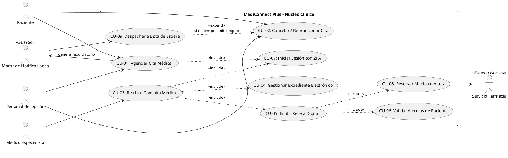
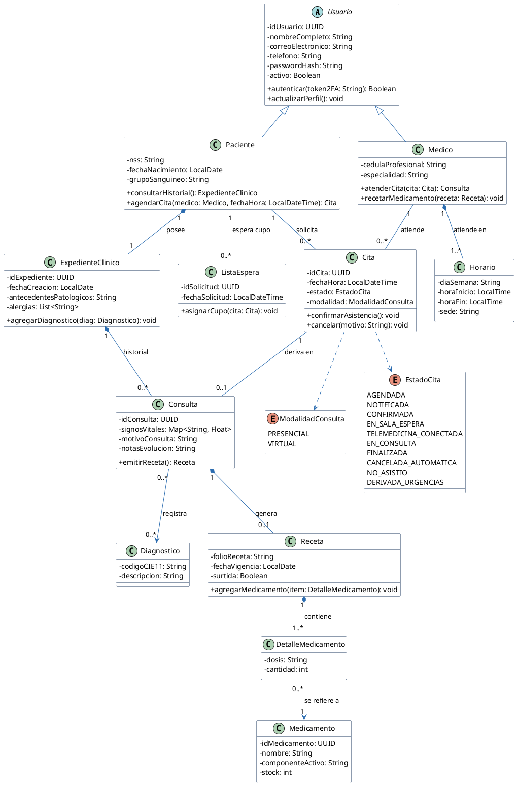
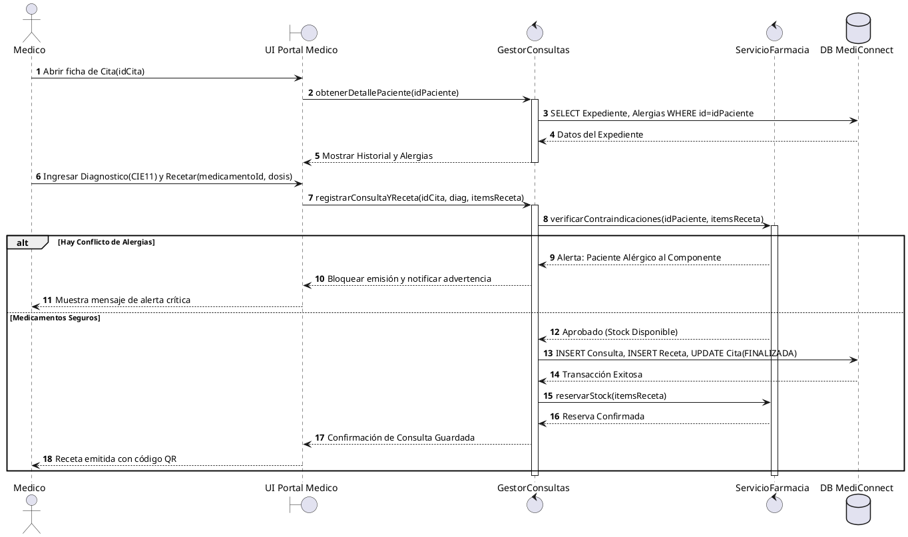
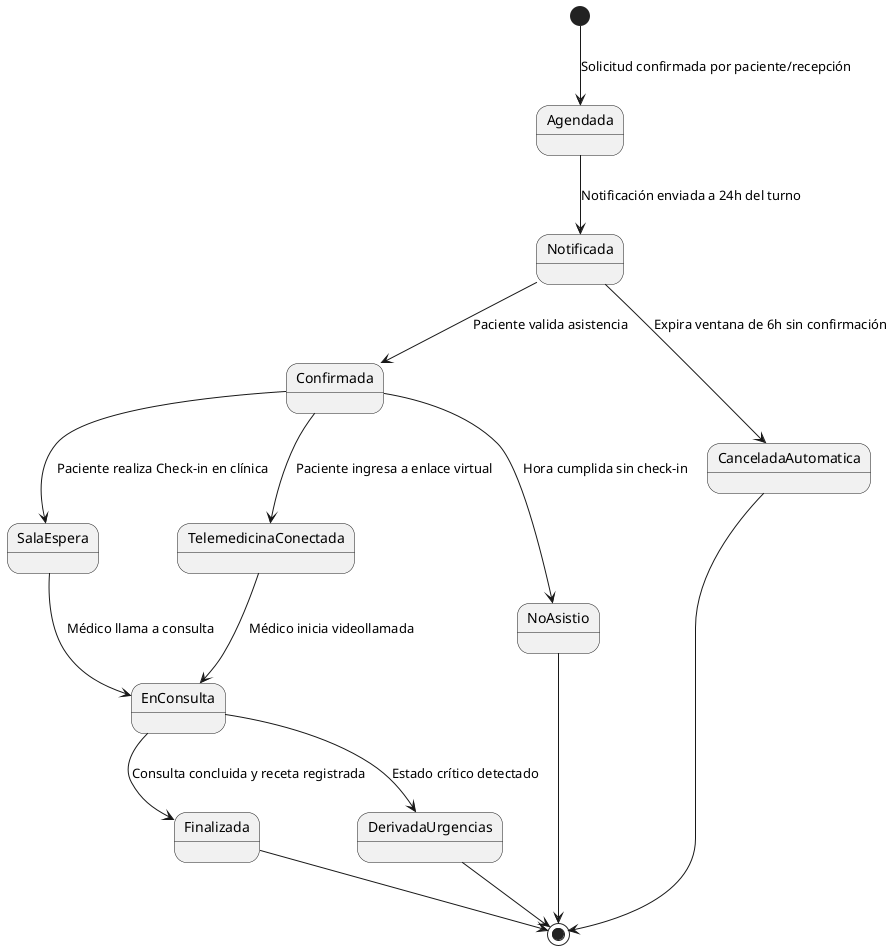
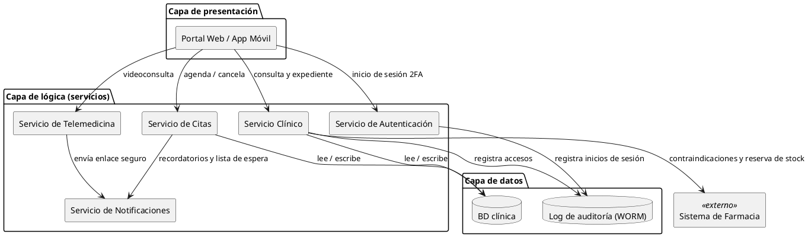

# Taller: Análisis de requisitos, del proyecto al modelo

**Materia:** Ingeniería de Requisitos
**Unidad II:** Elicitación y análisis de requisitos
**Duración:** 80 minutos
**Modalidad:** equipos de 3 o 4 estudiantes
**Entregable:** este mismo archivo `.md` completado (más su exportación a PDF)

---

## 0. Datos del equipo

| Campo | Respuesta |
|---|---|
| Nombre del proyecto | MediConnect Plus: Sistema Inteligente de Gestión Hospitalaria y Telemedicina |
| Integrantes | *(Nombre 1)* y *(Nombre 2)* |
| Fecha | 21/10/2026 |

**Roles del equipo** (asignen uno por persona; en equipos de 3, una persona toma dos roles):

| Rol | Responsable | Función |
|---|---|---|
| Analista líder | *(Nombre 1)* | Coordina el tiempo y revisa la coherencia del documento |
| Modelador | *(Nombre 2)* | Escribe y renderiza los diagramas PlantUML |
| Arquitecto | *(Nombre 2)* | Propone la arquitectura y la matriz de trazabilidad |
| Relator | *(Nombre 1)* | Documenta la negociación y presenta la conclusión final |

---

## Objetivo

Producir un mini documento de análisis de requisitos de su proyecto real que cubra los cinco elementos de la unidad: **clasificación, modelamiento conceptual, diseño arquitectónico y asignación, negociación y análisis formal**.

## Distribución del tiempo

| Tiempo | Bloque | Producto |
|---|---|---|
| 0-10 min | Contexto | Problema, alcance e interesados |
| 10-25 min | 1. Clasificación | Tabla de 12 requisitos clasificados y priorizados |
| 25-40 min | 2. Modelamiento conceptual | Diagrama de casos de uso y diagrama de clases (PlantUML) |
| 40-50 min | 3. Arquitectura y asignación | Diagrama de componentes y matriz de trazabilidad |
| 50-62 min | 4. Negociación | 2 conflictos resueltos con formato WinWin |
| 62-75 min | 5. Análisis formal | 3 requisitos reescritos y verificados |
| 75-80 min | Cierre | Revisión, entrega y conclusión oral de 1 minuto |

> **Tip de tiempo:** el Modelador puede empezar los diagramas del bloque 2 mientras los demás terminan la clasificación. Si el tiempo no alcanza, reduzcan a 8 requisitos y hagan solo el diagrama de casos de uso.

---

## Bloque de contexto (0-10 min)

### Descripción del proyecto

> La red privada de salud MediConnect Plus (3 hospitales, 10 clínicas y un servicio de telemedicina) opera con sistemas aislados y registros en papel, lo que causa retrasos en citas, recetas duplicadas y falta de trazabilidad. El proyecto es el núcleo transaccional web y móvil que unifica citas, expediente clínico único, recetas electrónicas con reserva en farmacia y videoconsultas cifradas. **Incluye:** gestión de citas y lista de espera, expediente, consulta, receta y telemedicina. **No incluye:** facturación, seguros, laboratorio ni imagenología. Beneficia a pacientes, médicos, personal de recepción y a la dirección médica de la red.

### Interesados (mínimo 4)

| # | Interesado | Rol | Qué espera del sistema |
|---|---|---|---|
| 1 | Dra. Elena Ruiz | Directora Médica | Expediente único por paciente en toda la red, diagnóstico CIE-11, receta electrónica ligada a farmacia y alerta de alergias |
| 2 | Carlos Mendoza | Coordinador de Recepción y Citas | Agenda ordenada, confirmación por correo o SMS, liberación automática de cupos y registro de urgencias sin turno |
| 3 | Ing. Mónica Valdés | Seguridad e Infraestructura | Cumplimiento HIPAA, 2FA, auditoría inmutable y videollamadas cifradas de extremo a extremo |
| 4 | Pacientes | Usuarios finales | Agendar, reprogramar y cancelar sin filas, recibir recordatorios y consultar por videollamada |
| 5 | Médicos y enfermeros | Personal clínico | Acceso rápido al expediente y a las alergias durante la consulta, sin pasos que retrasen la atención |
| 6 | Servicio de Farmacia | Sistema externo | Recibir recetas y reservas de medicamentos con inventario actualizado |

---

## Bloque 1. Clasificación de requisitos (10-25 min)

**Instrucciones:** redacten mínimo **12 requisitos** del proyecto y clasifíquenlos.

- **Tipo:** Funcional (RF), No funcional (RNF), Restricción (RES) o Regla de negocio (RN).
- **Categoría ISO 25010** (solo para RNF): rendimiento, seguridad, usabilidad, fiabilidad, mantenibilidad, compatibilidad, portabilidad, adecuación funcional.
- **Prioridad MoSCoW:** *Must* (indispensable), *Should* (importante), *Could* (deseable), *Won't* (no en esta versión).
- **ID único:** `RF-01`, `RNF-01`, `RES-01`, `RN-01`...

| ID | Descripción del requisito | Tipo | Categoría ISO 25010 | Prioridad MoSCoW |
|---|---|---|---|---|
| RF-01 | El sistema debe permitir a pacientes y recepcionistas agendar, reprogramar y cancelar citas presenciales o virtuales, verificando la disponibilidad de la agenda médica | Funcional | N/A | Must |
| RF-02 | El sistema debe registrar en un expediente único por paciente los antecedentes, alergias, diagnósticos (CIE-11), signos vitales y notas de evolución de cada consulta | Funcional | N/A | Must |
| RF-03 | El sistema debe permitir al médico emitir recetas digitales, alertarlo si un medicamento es contraindicado por las alergias del paciente y reservar el medicamento en el inventario de farmacia | Funcional | N/A | Must |
| RF-04 | El sistema debe generar un enlace seguro y tokenizado para la videoconsulta entre paciente y médico a la fecha y hora de la cita | Funcional | N/A | Should |
| RF-05 | El sistema debe liberar el cupo de una cita no confirmada y reasignarlo al siguiente paciente de la lista de espera | Funcional | N/A | Could |
| RNF-01 | La información médica debe viajar con TLS 1.3 y almacenarse cifrada con AES-256 | No funcional | Seguridad | Must |
| RNF-02 | La búsqueda de disponibilidad de médicos debe responder en 1.2 s o menos con 500 usuarios simultáneos | No funcional | Rendimiento | Should |
| RNF-03 | El sistema debe tener una disponibilidad anual de 99.9 % | No funcional | Fiabilidad | Should |
| RES-01 | El sistema debe cumplir con HIPAA y con la Ley de Protección de Datos Personales | Restricción | N/A | Must |
| RES-02 | Las videollamadas deben cifrarse de extremo a extremo y no pueden almacenarse en las terminales de los médicos | Restricción | N/A | Must |
| RN-01 | Todo acceso al expediente por parte de médicos y enfermeros requiere autenticación con doble factor (2FA) | Regla de negocio | N/A | Must |
| RN-02 | Toda lectura o modificación de un registro clínico debe quedar auditada con marca de tiempo inmutable e ID de usuario, en almacenamiento WORM | Regla de negocio | N/A | Must |

> **Nota:** RN-01 y RNF-03 se modificaron en el Bloque 4 (negociación). Allí está su texto vigente. RF-05 aplica la regla de la entrevista: se envía la notificación 24 h antes de la cita y, si el paciente no confirma en 6 h, el cupo se libera (es decir, 18 h antes de la cita).

**Autoevaluación rápida:**

- [x] Cada requisito tiene un ID único
- [x] Hay al menos un requisito de cada tipo
- [x] Los RNF tienen una categoría ISO 25010
- [x] No todos los requisitos son *Must*

---

## Bloque 2. Modelamiento conceptual (25-40 min)

**Instrucciones:** elaboren **dos modelos** con PlantUML embebido en este archivo. Reemplacen el contenido de las plantillas con los datos de su proyecto. Si necesitan ayuda con la sintaxis, consulten la guía `guia_markdown_plantuml.md`.

### 2.1 Diagrama de casos de uso (actores y mínimo 5 casos de uso)



**Descripción breve de los casos de uso** (relacionen cada uno con los requisitos del bloque 1):

| Caso de uso | Actor principal | Requisitos que cubre |
|---|---|---|
| CU-01 Agendar cita médica | Paciente, Personal de recepción | RF-01, RF-04, RN-01 |
| CU-02 Cancelar / reprogramar cita | Paciente, Personal de recepción | RF-01, RF-05 |
| CU-03 Realizar consulta médica | Médico especialista | RF-02, RF-04, RES-02, RN-02 |
| CU-04 Gestionar expediente electrónico | Médico especialista | RF-02, RES-01, RN-02 |
| CU-05 Emitir receta digital | Médico especialista | RF-03 |
| CU-06 Validar alergias del paciente | Sistema (incluido en CU-05) | RF-03 |
| CU-07 Iniciar sesión con 2FA | Médico, Personal de recepción | RN-01, RNF-01 |
| CU-08 Reservar medicamentos | Servicio de Farmacia | RF-03 |
| CU-09 Despachar a lista de espera | Motor de Notificaciones | RF-05 |

### 2.2 Modelo de dominio / diagrama de clases conceptual (mínimo 5 entidades)



**Pregunta de revisión:** ¿cada entidad del modelo aparece mencionada en al menos un requisito de la tabla del bloque 1? Si no, falta un requisito o sobra una entidad.

> Sí. `Cita`, `Horario` y `ModalidadConsulta` aparecen en RF-01; `ExpedienteClinico`, `Consulta` y `Diagnostico` en RF-02; `Receta`, `DetalleMedicamento` y `Medicamento` en RF-03; `ListaEspera` en RF-05; `Paciente` y `Medico` (con `Usuario`) en RF-01 a RF-04. El enum `EstadoCita` usa los mismos estados del diagrama de estados (2.4), que a su vez salen de RF-05 y de la regla de confirmación. Respecto a la plantilla original del caso de estudio, se agregaron las clases que se usaban sin definir (`Horario`, `DetalleMedicamento`, `ModalidadConsulta`, `Diagnostico`) y se movieron las alergias al expediente, porque así lo pide RF-02.

### 2.3 Diagrama de secuencia: atención de consulta y receta



### 2.4 Diagrama de estados: ciclo de vida de una cita




---

## Bloque 3. Diseño arquitectónico y asignación (40-50 min)

**Instrucciones:** propongan una arquitectura de alto nivel con **4 o más componentes** (por ejemplo: capas, cliente-servidor, microservicios) y asignen cada requisito al componente responsable.

### 3.1 Estilo arquitectónico elegido

| Estilo | Justificación (1-2 líneas) |
|---|---|
| Arquitectura en capas con servicios modulares (cliente-servidor) | Separa presentación, lógica y datos, y permite aislar los servicios críticos (autenticación, clínico) para darles mayor disponibilidad y auditoría, sin la complejidad de microservicios completos. |

### 3.2 Diagrama de componentes



### 3.3 Matriz de trazabilidad (requisito → componente)

Marquen con una **X** el componente responsable de cada requisito. Ajusten las columnas a los componentes de su diagrama.

| Requisito | Portal Web / App | Autenticación | Citas | Clínico | Telemedicina | Notificaciones | BD clínica | Auditoría WORM | Farmacia (ext.) |
|---|:---:|:---:|:---:|:---:|:---:|:---:|:---:|:---:|:---:|
| RF-01 | X | | X | | | X | X | | |
| RF-02 | X | | | X | | | X | | |
| RF-03 | X | | | X | | | X | | X |
| RF-04 | X | | | | X | X | | | |
| RF-05 | | | X | | | X | X | | |
| RNF-01 | X | X | | | | | X | X | |
| RNF-02 | | | X | | | | X | | |
| RNF-03 | | X | X | X | X | X | X | | |
| RES-01 | | X | | X | | | X | X | |
| RES-02 | X | | | | X | | | | |
| RN-01 | X | X | | | | | | | |
| RN-02 | | | | X | | | | X | |

**Verificación:**

- [x] Todos los requisitos están asignados al menos a un componente
- [x] Todos los componentes tienen al menos un requisito asignado (si alguno no tiene, ¿para qué existe?)

---

## Bloque 4. Negociación de requisitos (50-62 min)

**Instrucciones:**

1. Identifiquen **2 conflictos** entre requisitos o entre interesados (ejemplos: seguridad vs. usabilidad, costo vs. alcance, rendimiento vs. costo de infraestructura).
2. Realicen un **juego de roles de 6 minutos** por conflicto: dos integrantes defienden posiciones opuestas y los demás median.
3. Documenten el acuerdo con el formato WinWin: **conflicto → opciones → decisión → requisito modificado**.

### Conflicto 1

| Campo | Contenido |
|---|---|
| Requisitos o interesados en conflicto | RN-01 (2FA en todo acceso al expediente) vs. agilidad de la consulta (RF-02) |
| Posición A (quién y qué defiende) | Ing. Mónica Valdés (Seguridad): pedir 2FA en cada acceso al expediente para cumplir HIPAA |
| Posición B (quién y qué defiende) | Dra. Elena Ruiz (Dirección Médica) y médicos: un 2FA en cada apertura de expediente interrumpe la consulta y retrasa la atención |
| Opciones consideradas | 1. 2FA en cada acceso al expediente. <br> 2. 2FA solo al iniciar sesión, con sesión abierta todo el turno. <br> 3. 2FA al iniciar sesión, y verificación adicional solo para acciones críticas y tras inactividad. |
| Decisión tomada | Opción 3 |
| Justificación | Mantiene la protección en las operaciones de mayor riesgo y evita interrumpir la lectura normal durante la consulta. Cada acceso queda de todos modos auditado por RN-02. |
| Requisito modificado (ID y nuevo texto) | **RN-01:** El personal médico y de enfermería deberá autenticarse con 2FA al iniciar sesión. El sistema solicitará una verificación adicional antes de emitir una receta o modificar un diagnóstico, y tras 15 minutos de inactividad cerrará la sesión. |

### Conflicto 2

| Campo | Contenido |
|---|---|
| Requisitos o interesados en conflicto | RNF-03 (disponibilidad 99.9 %) vs. costo de infraestructura y alcance de la primera versión |
| Posición A (quién y qué defiende) | Ing. Mónica Valdés (Infraestructura): alta disponibilidad de 99.9 % en todos los servicios, porque es un sistema hospitalario |
| Posición B (quién y qué defiende) | Dirección de Transformación Digital: la redundancia completa de todos los servicios excede el presupuesto de la primera versión |
| Opciones consideradas | 1. Alta disponibilidad de 99.9 % en todos los servicios. <br> 2. Alta disponibilidad de 99.9 % solo en los servicios críticos y una meta menor para los demás. <br> 3. Servidor único con respaldos diarios. |
| Decisión tomada | Opción 2 |
| Justificación | La atención clínica depende de Autenticación, Servicio Clínico y BD. Citas y Notificaciones toleran una breve caída sin riesgo para el paciente. Se acota el costo sin comprometer la seguridad clínica. |
| Requisito modificado (ID y nuevo texto) | **RNF-03:** Los servicios de Autenticación, Clínico y la BD clínica tendrán una disponibilidad anual de 99.9 %. Los servicios de Citas, Telemedicina y Notificaciones tendrán 99.5 %. |

> **Atención:** el docente puede pasar por su equipo como "cliente difícil" e introducir un cambio de último minuto. Registren aquí cómo lo manejaron.
>
> *(Notas sobre el cambio de último minuto: se llena en clase, si el docente lo plantea)*

---

## Bloque 5. Análisis formal de requisitos (62-75 min)

**Instrucciones:** elijan **3 requisitos críticos** (de prioridad *Must*) y reescríbanlos de forma no ambigua con una de estas plantillas.

**Plantilla EARS:**

```text
Cuando <evento o condición>, el sistema deberá <respuesta medible>.
```

**Plantilla Given/When/Then:**

```text
Dado <contexto inicial>
Cuando <acción del usuario o evento>
Entonces <resultado observable y medible>
```

### Requisito formal 1

| Campo | Contenido |
|---|---|
| ID original | RF-03 |
| Texto original (ambiguo) | El sistema debe avisar al médico si el medicamento es peligroso para el paciente. |
| Texto reescrito | **Dado** un paciente con una alergia severa registrada en su expediente a un componente activo, **cuando** el médico agrega a la receta un medicamento que contiene ese componente, **entonces** el sistema bloquea la emisión de la receta y muestra una alerta crítica con el nombre del componente en 2 segundos o menos. |
| Criterio de aceptación medible | En una prueba con 20 casos de contraindicación, el 100 % se bloquea y no se genera ningún folio de receta. La alerta aparece en 2 s o menos en al menos el 95 % de los casos. |

### Requisito formal 2

| Campo | Contenido |
|---|---|
| ID original | RF-01 |
| Texto original (ambiguo) | El sistema debe permitir agendar citas de forma fácil y rápida. |
| Texto reescrito | **Cuando** un paciente o recepcionista confirme una solicitud de cita con especialidad, sede, médico y horario disponible, el sistema deberá registrar la cita, marcar ese horario como ocupado y mostrar el comprobante en 3 segundos o menos. |
| Criterio de aceptación medible | El 95 % de las solicitudes se confirma en 3 s o menos. Si dos usuarios solicitan el mismo horario al mismo tiempo, el sistema acepta una sola y rechaza la otra con un mensaje. |

### Requisito formal 3

| Campo | Contenido |
|---|---|
| ID original | RNF-01 |
| Texto original (ambiguo) | La información médica debe viajar y guardarse de forma segura. |
| Texto reescrito | **Cuando** el sistema transmita información clínica, deberá usar TLS 1.3 como mínimo, y **cuando** la almacene, deberá cifrarla con AES-256. |
| Criterio de aceptación medible | Un escaneo de configuración TLS no detecta ningún punto de acceso con versión menor a 1.3. La revisión de la BD y de los respaldos confirma que el 100 % de los datos clínicos está cifrado con AES-256. |

### Lista de verificación de calidad

Marquen con una **X** si el requisito cumple. Si algún cuadro queda vacío, corrijan el requisito.

| Criterio | Req. 1 | Req. 2 | Req. 3 |
|---|:---:|:---:|:---:|
| **Completo:** no le falta información para implementarlo | X | X | X |
| **Consistente:** no contradice otro requisito | X | X | X |
| **Verificable:** se puede probar con un criterio medible | X | X | X |
| **No ambiguo:** admite una sola interpretación | X | X | X |
| **Trazable:** tiene ID y está asignado a un componente | X | X | X |

> **Señales de ambigüedad:** palabras como *rápido*, *fácil*, *adecuado*, *amigable*, *etc.*, *y/o*, *normalmente*. Sustitúyanlas por cifras (por ejemplo, "en menos de 2 segundos para el 95 % de las consultas").

---

## Cierre (75-80 min)

- [ ] Revisamos que los dos diagramas PlantUML se rendericen sin errores
- [ ] Revisamos que las tablas se vean correctamente en la vista previa
- [ ] Exportamos el documento a PDF
- [ ] Subimos el entregable
- [ ] El relator preparó su conclusión oral de 1 minuto

### Conclusión del relator

**Principal hallazgo o riesgo detectado durante el análisis:**

> El mayor riesgo es el choque entre seguridad (2FA, auditoría, cifrado) y la agilidad de la atención clínica: si la seguridad frena al médico en consulta, el sistema no se usará, y si se relaja, se incumple HIPAA. La solución fue pedir 2FA al iniciar sesión y verificar de nuevo solo en acciones críticas.

---

## Rúbrica de evaluación (100 puntos)

| Criterio | Excelente | Suficiente | Insuficiente | Puntos |
|---|---|---|---|:---:|
| **Clasificación y priorización** | 12+ requisitos, bien clasificados, con ISO 25010 y MoSCoW coherente (18-20) | 8-11 requisitos o errores menores de clasificación (12-17) | Menos de 8 o clasificación incorrecta (0-11) | /20 |
| **Modelos conceptuales** | Ambos modelos completos, coherentes entre sí y con los requisitos (18-20) | Modelos incompletos o con inconsistencias leves (12-17) | Falta un modelo o no se relacionan con los requisitos (0-11) | /20 |
| **Arquitectura y trazabilidad** | 4+ componentes, matriz completa y sin requisitos huérfanos (18-20) | Matriz con algunos requisitos sin asignar (12-17) | Sin matriz o arquitectura incoherente (0-11) | /20 |
| **Negociación documentada** | 2 conflictos reales, con opciones, decisión justificada y requisito modificado (18-20) | 2 conflictos con justificación débil, o solo 1 completo (12-17) | Conflictos superficiales o sin decisión documentada (0-11) | /20 |
| **Formalización y calidad** | 3 requisitos en EARS/GWT, medibles y con lista de verificación aplicada (14-15) | Requisitos reescritos pero con criterios poco medibles (9-13) | Sin reescritura o siguen siendo ambiguos (0-8) | /15 |
| **Organización y trabajo en equipo** | Documento ordenado, PlantUML renderiza, roles cumplidos (5) | Detalles menores de formato (3-4) | Documento desordenado o sin renderizar (0-2) | /5 |
| | | | **TOTAL** | **/100** |

**Retroalimentación del docente:**

> &nbsp;
>
> &nbsp;